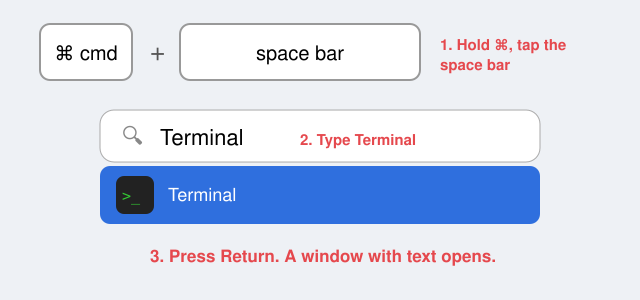
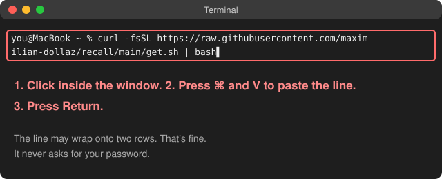
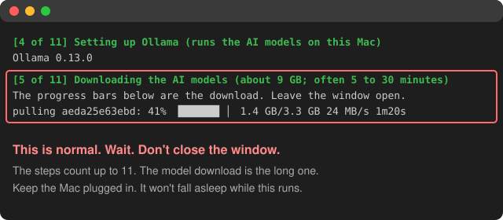
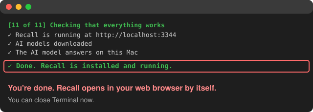
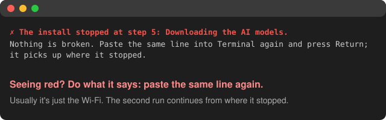

# Install Recall on your Mac

Recall keeps everything you save (pictures, links, notes, voice notes) and finds it again when you describe it. It runs entirely on your own Mac, with its own AI, so nothing you save leaves your computer.

This guide takes about **5 minutes of your time**, then **15 to 45 minutes of waiting** while your Mac downloads the AI.

> **Have Claude?** You can let it do this for you. See [Let your AI install it](#let-your-ai-install-it) at the bottom.

---

## Before you start

- A **Mac with Apple Silicon** (M1, M2, M3, M4 or newer), **macOS 14 or newer**, **8 GB memory or more**.
- About **15 GB of free space**.
- The Mac **plugged in** and on **Wi-Fi**.

Not sure? Check like this:


1. Click the **Apple** in the very top-left corner of the screen.
2. Click **About This Mac**.
3. **Chip** should say **Apple M** something. **Memory** should be **8 GB** or more. **macOS** should be **14** (Sonoma) or newer.

If the Chip says **Intel**, Recall won't run well on this Mac. Stop here and tell the person who sent you this.

---

## Step 1. Open Terminal

Terminal is an app that's already on every Mac. It's where you'll paste one line.



1. Hold down the **⌘ (command)** key and tap the **space bar**. A search bar appears.
2. Type **Terminal**.
3. Press **Return**. A window with some text opens.

## Step 2. Copy the line

Click the copy button (two little squares) on the right of the box below. Or select the whole line and press **⌘ C**.

```
curl -fsSL https://raw.githubusercontent.com/maximilian-dollaz/recall/main/get.sh | bash
```

## Step 3. Paste it and press Return



1. Click inside the Terminal window.
2. Hold **⌘** and press **V**. The line appears.
3. Press **Return**.

It **never asks for your password**. If anything asks for a password, don't type it; see [If something goes wrong](#if-something-goes-wrong).

## Step 4. Wait



Green steps count up from **1 of 11** to **11 of 11**. Step 5, downloading the AI, is the long one: a progress bar shows how far along it is.

- **Leave the window open.** Closing it stops the install.
- The Mac won't fall asleep while it runs. Keep it plugged in.
- You can use other apps meanwhile.

## Step 5. Done



When it says **✓ Done. Recall is installed and running**, Recall opens in your web browser by itself. You can close Terminal.

From now on:
- **Open Recall** any time by double-clicking **Recall** on your Desktop, or going to **http://localhost:3344** in your browser.
- It **starts by itself** when the Mac starts.
- **To update**, do steps 1 to 3 again. Your saved things stay.

---

## If something goes wrong



| You see | Do this |
| --- | --- |
| Red text: **The install stopped at step …** | Paste the same line again and press Return. It continues where it stopped. Most often it was the Wi-Fi. |
| It stops at the **same step twice** | Send the file it names (`~/.recall/logs/install.log`) to the person who sent you Recall. To find it: in Finder, click **Go** in the top menu, then **Go to Folder…**, paste `~/.recall/logs`, press Return. |
| **needs a Mac with Apple Silicon** | This Mac has an Intel chip. Recall can't run on it. |
| **needs macOS 14** | Update the Mac: Apple menu → **System Settings** → **General** → **Software Update**. Then try again. |
| **needs about … GB of free disk** | Empty the Trash and delete big old downloads, then try again. |
| A window asks to install **command line developer tools** | Click **Not Now**. Recall doesn't need them. |
| Anything asks for your **password** | Don't type it. Click **Cancel** and tell the person who sent you Recall. |
| Nothing seems to happen for a long time | Look for a progress bar or a percentage. If the last line hasn't changed for 30 minutes, press **Control C**, then paste the line again. |

---

## Let your AI install it

**Claude with access to your Mac** (the Claude desktop app with Claude Code or computer use turned on) can run the install for you. Paste this to it:

```
Install Recall on my Mac. Read this page and follow it exactly:
https://raw.githubusercontent.com/maximilian-dollaz/recall/main/AI-INSTALL.md
```

**ChatGPT, or Claude in a browser**, can't type into your Mac's Terminal, but they can walk you through it one step at a time and read your screenshots. Paste the same message.

---

## What gets installed, and where

Everything goes inside your own home folder. Nothing needs an admin password.

| What | Where | Why |
| --- | --- | --- |
| Recall | `~/Recall` | The app. Your library lives in `~/Recall/library`. |
| Ollama | `~/Applications/Ollama.app` (or the one you already have) | Runs the AI models on your Mac. |
| The AI models | `~/.ollama` | Gemma 3 (sees pictures), plus Qwen 3 on Macs with 16 GB or more (writes titles and sorts), plus a small search model. 4 to 9 GB. |
| Tools | `~/.recall`, `~/.bun` | Bun, ffmpeg, pdftotext, Python, git: what Recall uses to read files, voice and video. |
| GBrain | `~/.gbrain` | The library's database and search. |

To remove Recall: `zsh ~/Recall/uninstall.sh` in Terminal. It asks before deleting your library.
