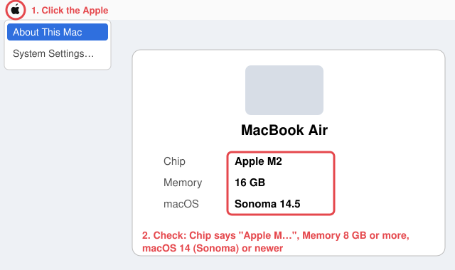

# Install Recall on your Mac

Recall keeps everything you save (pictures, links, notes, voice notes) and finds it again when you describe it. It runs entirely on your own Mac, with its own AI, so nothing you save leaves your computer.

It takes about **5 minutes of your time**, then **15 to 45 minutes of waiting** while your Mac downloads the AI. **You don't need a GitHub account**, and with Claude you don't need Terminal either.

---

## The easy way: Claude installs it (no Terminal)

You need the **Claude app for Mac** and a Claude plan that includes Claude Code (Pro or Max).

1. Download Claude for Mac from **claude.ai/download**, open it, and sign in.
2. Click the **Code** tab at the top.
3. Under the message box, set the place it runs to **Local** (not Cloud), and pick a folder, for example your **home folder** (the one with your name).
   *If you see "Connect GitHub", you're on **Cloud**. Switch to **Local**: Recall doesn't need GitHub.*
4. Paste this and press Return:

```
Install Recall on my Mac. Read this page and follow it exactly: https://raw.githubusercontent.com/maximilian-dollaz/recall/main/AI-INSTALL.md
```

5. Claude checks your Mac, helps free space if needed (it asks you about each thing first), installs Recall, and connects your iPad if you have one. When it asks to run a command, click **Allow** (or **Always allow** for this session). When a macOS window asks for **your Mac's password**, type it there, never into the chat.

That's it. The rest of this page is the same install done by hand, for anyone without Claude.

---

# By hand, with Terminal

## Before you start

You need a **Mac with Apple Silicon** (M1 or newer), **macOS 14 or newer**, **8 GB memory or more**, and enough **free space** (below). Keep it **plugged in** and on **Wi-Fi**.

| Free space | What happens |
| --- | --- |
| **50 GB or more** | ✓ Ready. Plenty of room left for macOS updates and everything you save. |
| **25 to 50 GB** (or 20 to 50 GB on an 8 GB Mac) | ! It installs, but the Mac will be fairly full. Free some space if you can. |
| **Less than 25 GB** (less than 20 GB on an 8 GB Mac) | ✗ It won't install. Free space first. |

Why those numbers: Recall and its AI take about **12 GB** (about 8 GB on an 8 GB Mac). After that, a Mac needs at least **10 GB** free to keep running well, and a macOS update needs 25 to 35 GB.

**You don't have to work this out yourself.** The installer checks first and stops before downloading anything if the Mac isn't ready. To check without installing, do steps 1 to 3 below with this line instead:

```
curl -fsSL https://raw.githubusercontent.com/maximilian-dollaz/recall/main/check.sh | bash
```

It prints ✓, ! or ✗ for the chip, macOS, memory and free space, and says what to do about anything that's missing.

**Short on space?** A helper frees it safely. It shows what's taking room and asks before removing each thing: big old files in Downloads (moved to the Trash, only the ones you pick), app caches (apps rebuild them), then emptying the Trash, then Apple's own Storage settings for old iPhone backups and unused apps. It never touches Documents, Desktop, Photos or anything else of yours. The installer offers it by itself when space is short, or run it any time:

```
curl -fsSL https://raw.githubusercontent.com/maximilian-dollaz/recall/main/free-space.sh | bash
```

To see it yourself: click the **Apple** in the top-left corner → **About This Mac**.



For free space: Apple menu → **System Settings** → **General** → **Storage**.

---

## Step 1. Open Terminal

Terminal is an app that's already on every Mac. It's where you'll paste one line.


1. Hold down the **⌘ (command)** key and tap the **space bar**. A search bar appears.
2. Type **Terminal**.
3. Press **Return**. A window with some text opens.

## Step 2. Copy the line

Click the copy button (two little squares) on the right of the box below. Or select the whole line and press **⌘ C**.

```
curl -fsSL https://raw.githubusercontent.com/maximilian-dollaz/recall/main/get.sh | bash
```

## Step 3. Paste it and press Return


1. Click inside the Terminal window.
2. Hold **⌘** and press **V**. The line appears.
3. Press **Return**.

It **never asks for your password**. If anything asks for a password, don't type it; see [If something goes wrong](#if-something-goes-wrong).

## Step 4. Wait


Green steps count up from **1 of 11** to **11 of 11**. Step 5, downloading the AI, is the long one: a progress bar shows how far along it is.

- **Leave the window open.** Closing it stops the install.
- The Mac won't fall asleep while it runs. Keep it plugged in.
- You can use other apps meanwhile.

## Step 5. Done


When it says **✓ Done. Recall is installed and running**, Recall opens in your web browser by itself. You can close Terminal.

From now on:
- **Open Recall** any time by double-clicking **Recall** on your Desktop, or going to **http://localhost:3344** in your browser.
- It **starts by itself** when the Mac starts.
- **To update**, do steps 1 to 3 again. Your saved things stay.

---

## Will it slow my Mac down?

No more than it has to. The AI only runs while Recall is filing something you saved, then **leaves memory 2 minutes later**. Only **one model is loaded at a time**, and Recall runs at **lower priority** than the apps you're using, so your work goes first. On an 8 GB Mac, other apps may pause for a moment while a save is being filed.

---

## Use Recall on your iPad or iPhone

The iPad uses Recall on your Mac, privately, through **Tailscale** (a free app that links your own devices). It works anywhere the iPad has internet, as long as the Mac is on.

**On the Mac** (once): open Terminal, paste this, press Return:

```
zsh ~/Recall/connect-ipad.sh
```

It installs Tailscale (it asks for the **Mac's password** once, to install the app), asks you to sign in to Tailscale, turns on Recall's private address, and links it to your library. Sign in with **the account you'll also use on the iPad** (Google or Apple). If a page asks you to **Enable** HTTPS, click Enable.

At the end it shows a **QR code** and an address like `https://your-mac.tail1234.ts.net`.

**On the iPad:**
1. App Store → search **Tailscale** → **Get** → open it.
2. Sign in with **the same account** as on the Mac. Tap **Allow** when it asks to add a VPN.
3. Point the camera at the QR code on the Mac and tap the link (or type the address into Safari).
4. Tap **Share** (the square with an arrow) → **Add to Home Screen**. Recall is now an app on the iPad.

Keep the Mac plugged in and set it not to sleep: System Settings → **Battery** → **Options** → turn on **Prevent automatic sleeping on power adapter when the display is off**.

---

## If something goes wrong


| You see | Do this |
| --- | --- |
| Red text: **The install stopped at step …** | Paste the same line again and press Return. It continues where it stopped. Most often it was the Wi-Fi. |
| It stops at the **same step twice** | Send the file it names (`~/.recall/logs/install.log`) to the person who sent you Recall. To find it: in Finder, click **Go** in the top menu, then **Go to Folder…**, paste `~/.recall/logs`, press Return. |
| **Chip ✗ (Intel)** | Recall can't run on this Mac. |
| **macOS ✗** | Update the Mac: Apple menu → **System Settings** → **General** → **Software Update**. Then try again. |
| **Free space ✗** | It says how much to free. Empty the Trash, delete big files in Downloads, and see System Settings → General → Storage. Then try again. |
| The iPad says **can't connect** or the page won't load | Check the Mac is on and awake, and Tailscale on both shows Connected with the same account. |
| A window asks to install **command line developer tools** | Click **Not Now**. Recall doesn't need them. |
| Anything asks for your **password** | Don't type it. Click **Cancel** and tell the person who sent you Recall. |
| Nothing seems to happen for a long time | Look for a progress bar or a percentage. If the last line hasn't changed for 30 minutes, press **Control C**, then paste the line again. |

---

## What gets installed, and where

Everything goes inside your own home folder. Nothing needs an admin password.

| What | Where | Why |
| --- | --- | --- |
| Recall | `~/Recall` | The app. Your library lives in `~/Recall/library`. |
| Ollama | `~/Applications/Ollama.app` (or the one you already have) | Runs the AI models on your Mac. |
| The AI models | `~/.ollama` | Gemma 3 (sees pictures), plus Qwen 3 on Macs with 16 GB or more (writes titles and sorts), plus a small search model. 4 to 9 GB. |
| Tools | `~/.recall`, `~/.bun` | Bun, ffmpeg, pdftotext, Python, git: what Recall uses to read files, voice and video. |
| GBrain | `~/.gbrain` | The library's database and search. |

To remove Recall: `zsh ~/Recall/uninstall.sh` in Terminal. It asks before deleting your library.
