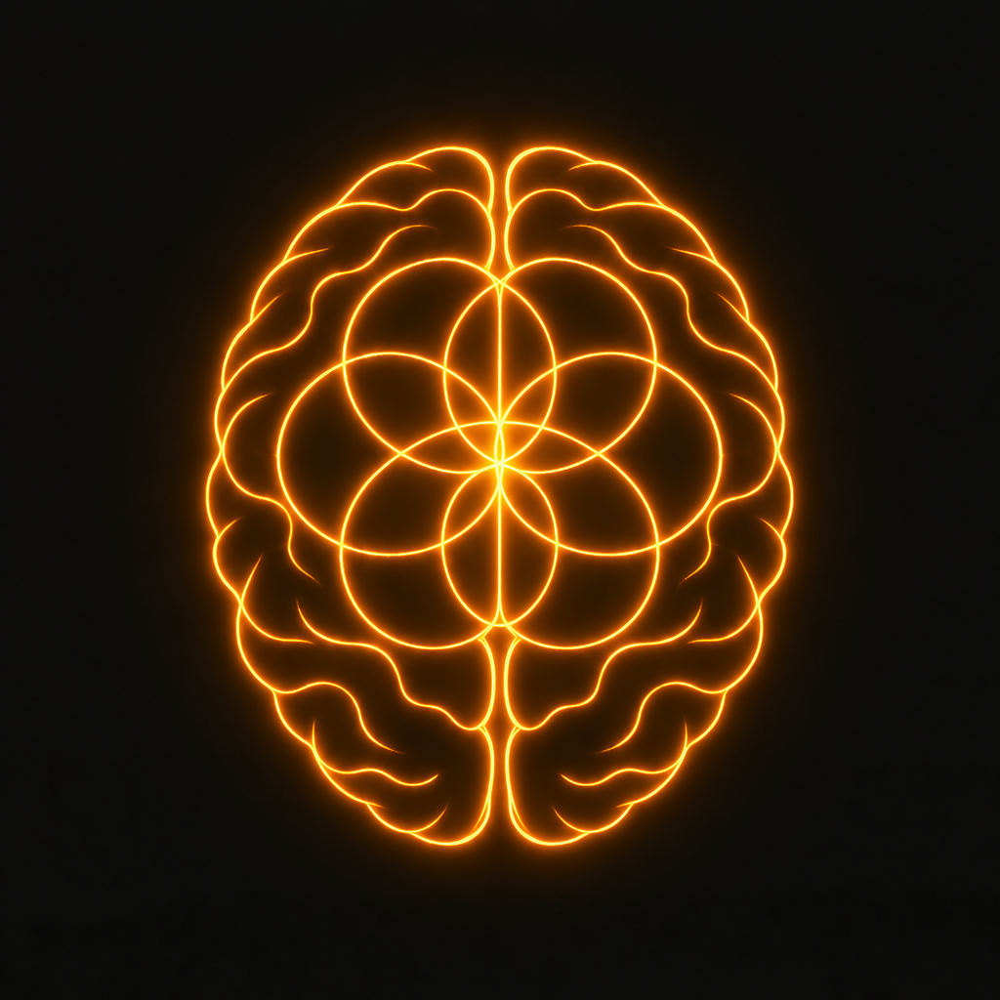

<p align="center"></p>

# Recall

Recall is a visual database for inspired creation.

Save anything from your phone or computer: a photo, a link, a document, a voice note. Say in one sentence what it is and what it's for. A librarian on your own computer sorts it into the right project. Months later, describe it in your own words and it comes back. Share a project with your team on a board, and turn what's on the board into a new picture together.

## Why it exists

> "I record something … but it never gets sorted anywhere and it never gets revisited. It gets lost."
> — Max, 30 Oct 2026

Recall was built for a small team creating two physical spaces, a wellness lounge and a zero-proof bar, with everyone's inspiration scattered across camera rolls, notes apps, docs and meetings. The full story, in the builder's own words: [STORY.md](STORY.md).

## What it's for

- **Capture in one step.** On iPhone, share anything to the Save to Recall shortcut. On a Mac, press ⌃⌥S anywhere. Say what it is and what it's for, and Recall tags and files it for you.
- **Keep inspiration in one place.** Photos from your camera roll, pins, web pages, Google Docs, PDFs, voice notes and videos.
- **Never sort by hand.** You say what it's for; Recall files it. When it can't tell, it asks one question (Clarify).
- **Find it by describing it.** "The pillow with the Middle Eastern pattern, around October."
- **See a whole project at once.** Every picture, note and doc for one project on one board.
- **Build with your team.** Share projects to a Dream board; everyone's saves appear together with their name.
- **Make the picture in everyone's head.** Creator mode turns pictures and words from a board into a new image.
- **Get your best ideas back.** Say "bring this back next Friday" and it does.
- **Long documents and meetings, in pieces.** Each idea, action and decision is pulled out and sorted on its own, linked back to its spot.

## How it works, in one paragraph

Everything runs on one Mac. A Bun web app takes each save, keeps the original, and hands it to a small local model (Gemma 3 4B through Ollama) that reads it, describes pictures, and decides the project from what you said. Each save becomes a markdown page in [GBrain](https://github.com/garrytan/gbrain), which indexes it for search with local embeddings. Phones and other computers reach the Mac through a private Tailscale network or a Cloudflare tunnel, and people sign in with Google. Full picture: [ARCHITECTURE.md](ARCHITECTURE.md).

The design copies nature, one system per job: a tree for shape, streams for saving, a watershed for sorting, a reservoir for keeping, a delta for long documents, cells for topics. How each one works: [docs/nature.md](docs/nature.md).

## Privacy

What you save stays on the Mac that runs Recall. Each person has their own library; nobody else sees it unless they share a project to a board. The only things that leave the Mac are the ones you turn on: Google sign-in, Chrome's speech service in the Chrome extension, Deepgram for voice (if you add a key), and Higgsfield or OpenAI for Creator mode (if you add a key). Libraries, keys and settings are never committed to this repository.

## Install

You need a Mac with Apple Silicon (M1 or newer), macOS 14 or later, 8 GB of memory (16 GB recommended) and at least 25 GB free (20 GB on an 8 GB Mac; 50 GB is comfortable). `check.sh` checks all of it without installing anything, and the installer runs the same check first. Open Terminal, paste this line, press Return:

```bash
curl -fsSL https://raw.githubusercontent.com/maximilian-dollaz/recall/main/get.sh | bash
```

It needs no admin password, Homebrew or Xcode. It installs into your home folder: Recall in `~/Recall`, its tools (Bun, ffmpeg, pdftotext, Python, git) in `~/.recall` and `~/.bun`, Ollama and the local models (Gemma 3 4B for pictures, plus Qwen 3 8B for writing and sorting on Macs with 16 GB), GBrain and the library server, then starts Recall at http://localhost:3344 and checks that the model answers. About 15 to 45 minutes, most of it the model download. Run it again any time to update or to finish an install that stopped.

- **Step by step with pictures, for anyone:** [INSTALL.md](INSTALL.md)
- **No Terminal, no GitHub account:** in the Claude app for Mac, open the Code tab, choose Local, and paste the prompt below. Claude runs the check, the clean-up, the install and the iPad link itself.
- **Let an AI assistant do it:** paste `Install Recall on my Mac. Read this page and follow it exactly: https://raw.githubusercontent.com/maximilian-dollaz/recall/main/AI-INSTALL.md` into Claude or ChatGPT. [AI-INSTALL.md](AI-INSTALL.md)
- **On an iPad or iPhone:** `zsh ~/Recall/connect-ipad.sh` on the Mac links it privately through Tailscale and shows a QR code to open on the iPad.
- **From a git checkout:** `zsh install.sh`. **To remove:** `zsh ~/Recall/uninstall.sh`.

On your own Mac, Recall needs no sign-in: it's yours. To let other people or your phone reach it, set your Google account as the owner in `.env`, then `cl app restart`:

### Settings (`.env`)

| Setting | What it is |
| --- | --- |
| `RECALL_PUBLIC_URL` | The address people open Recall at. `http://localhost:3344` on your own Mac. |
| `RECALL_OWNER_EMAIL` | The Google account that owns this Recall. |
| `RECALL_OWNER_NAME` | Your first name, as people see it ("Ask Sam for a new link"). |
| `RECALL_OPERATOR` | Who runs this Recall, for the privacy page. |
| `RECALL_CONTACT_EMAIL` | Where people write to have their library deleted. |
| `CL_HTTPS_HOST` | Your Mac's Tailscale name, for phones on your private network (optional). |

Google sign-in needs a Google Cloud OAuth client ID in `library/google.json` (`{"clientId": "…"}`). Keys for optional services (Deepgram, Higgsfield, OpenAI, Resend) are pasted on the Keys page inside Recall, never into files.

### Reaching it from phones and other people

- **Your own phone:** install Tailscale on the Mac and the phone, then open `https://<your-mac>.<tailnet>.ts.net`.
- **Your team, from anywhere:** put Recall's public door (port 3346) behind a domain with a named Cloudflare tunnel, then set `RECALL_PUBLIC_URL` and send the team link from `cl team-link`:

  ```bash
  cloudflared tunnel login && cloudflared tunnel create recall && cloudflared tunnel route dns recall recall.example.com
  ```

  Then write `~/.cloudflared/recall.yml` (`tunnel: recall`, `credentials-file:` the JSON it made, and an ingress rule sending `recall.example.com` to `http://127.0.0.1:3346`), and run it as a service from `server/com.recall.cftunnel.plist`.
- **Recall for Chrome:** load `extension/` in Chrome (Developer mode, Load unpacked). Change the address in `extension/recorder.js` and `extension/manifest.json` to yours first.

## Use it

- **iPhone:** the setup page adds a Save to Recall shortcut. Share anything to it and talk.
- **Mac:** press ⌃⌥S anywhere, or drop anything on the Save page.
- **Chrome:** right-click anything, Add to Recall, and talk.
- **Find:** describe what you're looking for, or open a project.
- **Clarify:** answer the one question Recall couldn't answer on its own.

From the terminal:

```
cl team-link [--new]            the link for your team (sign in with Google)
cl invite <name> [email]        a personal invite link
cl app start|stop|restart       the app
cl twin start|stop              a scratch copy for testing (ports 4344-4346)
cl ask "question"               search from the terminal
cl status                       what's in the library
```

## Develop

- Every change is tried on the twin first: `cl twin start`, then http://localhost:4344. It runs the same code against a scratch library.
- Tests: `bun test tests/<file>.test.ts` (run each file on its own).
- Everything committed here is public. A pre-commit hook (`tools/check-public.ts`) blocks secrets and the private words listed in your own `private/denylist.txt`. CI runs the same check.
- **The Soul Map** (optional, `RECALL_SOUL=1 zsh install.sh`): a separate companion app that learns how each person likes to work; Recall serves it at `/soul`. It will be open-sourced on its own.
- Roadmap: [ROADMAP.md](ROADMAP.md). How to help: [CONTRIBUTING.md](CONTRIBUTING.md). Security reports: [SECURITY.md](SECURITY.md).

## Credits

Built on [GBrain](https://github.com/garrytan/gbrain) (MIT) by Garry Tan, [Ollama](https://ollama.com), Gemma 3, nomic-embed-text and [mlx-whisper](https://github.com/ml-explore/mlx-examples). Fonts: Cormorant Garamond and Inter (SIL Open Font License). Delta photograph: Saloum Delta, Senegal, by Curioso Photography on Unsplash (Unsplash License).

## License

[MIT](LICENSE)
